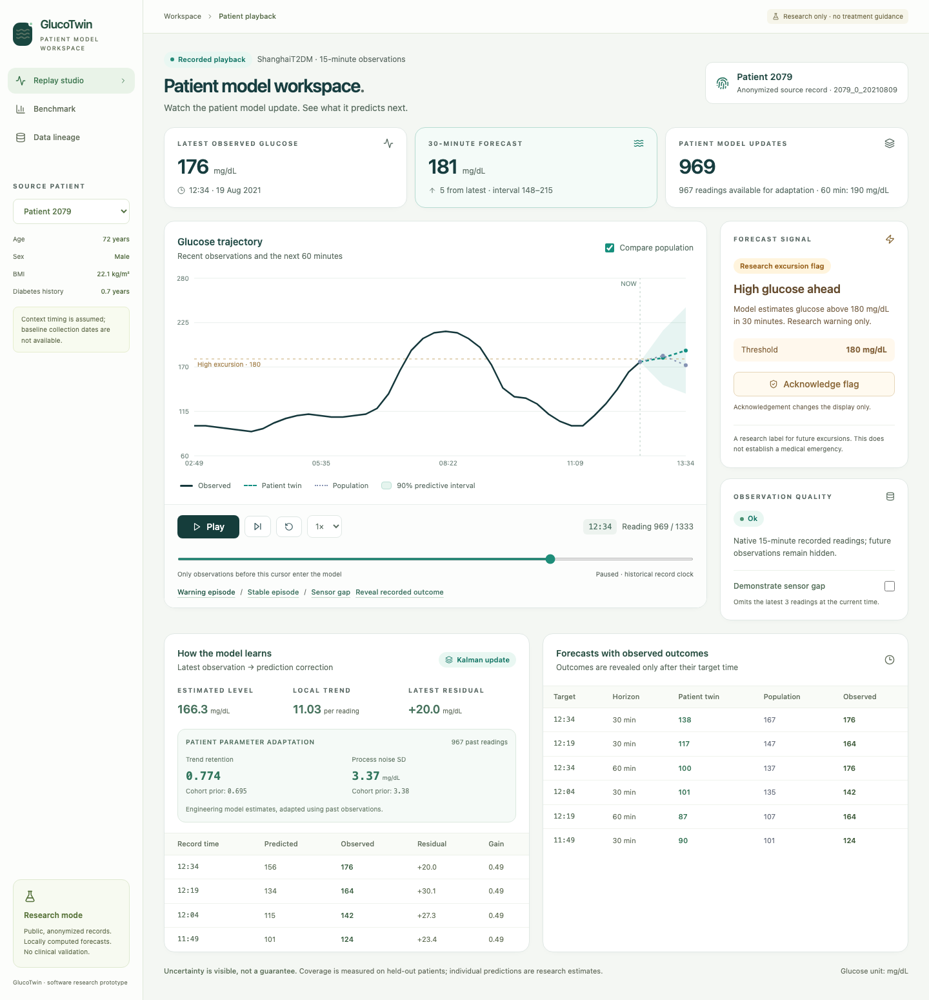

# GlucoTwin - watch the patient model learn

A local research prototype for the Digital Twin Challenge 2026. The core journey is a doctor opening an anonymized patient, replaying recorded glucose observations, watching a patient state update, inspecting future forecasts, and later comparing them with observed outcomes.

Built for the output of four workstreams: data/evaluation, twin/backend, product, and research/submission.

## First measured benchmark

The first reproducible split uses 70 training, 15 interval-calibration and 15 test patients, keeping all recordings from each patient together. Scores below are over eligible native windows; there are 15,843 30-minute test predictions. This is one retrospective split, not prospective validation.

| Model | 30-minute MAE (mg/dL) | 60-minute MAE (mg/dL) |
|---|---:|---:|
| Persistence | 12.76 | 21.16 |
| Linear trend | 16.92 | 30.56 |
| Population + baseline context | 10.53 | 18.76 |
| Population without baseline context | 10.26 | 17.69 |
| Pooled-parameter filter | 14.81 | 22.55 |
| Patient-adapted filter | 14.48 | 22.33 |

The patient-adapted filter improves modestly over the same pooled filter, but performs worse than persistence and population forecasting. Its 60-minute paired patient-bootstrap improvement is inconclusive at 95%. Adding baseline context did not improve the population model in this split. The dashboard reports these findings, weak warning recall and actual failure cases. The next modeling milestone is to strengthen adaptation and evaluate repeated patient splits before making a superiority claim.

The demo defaults to held-out **Patient 2079** at cursor 965. **Warning episode** jumps to cursor 968; **Reveal recorded outcome** jumps to 970. This is a retrospectively curated demonstration, separate from model fitting and runtime inputs. The 30-minute personalized estimate is 181.41 mg/dL and the observed outcome 181.8 mg/dL; this one success is not overall performance evidence.

## Run locally

Prerequisites: Python 3.12+ and Node.js 20+. The tested environment is Python 3.12.14 and Node 24.13.1. The app uses public data and local computation; no API keys or paid services are required. Setup uses pinned Python and npm lockfiles so the trained scikit-learn artifact matches the runtime.

```bash
./scripts/setup.sh
./start.sh
```

Open http://127.0.0.1:5173. Keep the terminal running. The API is at http://127.0.0.1:8765 and its interactive documentation at `/docs`.

For separate terminals:

```bash
# API (from the project root)
.venv/bin/python -m uvicorn backend.main:app --host 127.0.0.1 --port 8765

# Dashboard
npm --prefix frontend run dev -- --host 127.0.0.1 --port 5173 --strictPort
```

If these ports are occupied, use `GLUCOTWIN_API_PORT=8766 GLUCOTWIN_UI_PORT=5174 ./start.sh`. The launcher passes the matching proxy target and stops only its own processes on Ctrl+C.

## Data and model boundaries

ShanghaiT2DM recordings retain their native 15-minute resolution. Patient groups remain separate across model training and evaluation. The initial context excludes lab values with unverified pre-prediction availability. Every replay forecast is computed only from observations at or before its cursor. Future actuals appear only after their timestamps have been reached.

The core model is an interpretable state filter with visible state updates and patient parameter adaptation. A learned population model and simple baselines provide comparisons. Numerical metrics in the benchmark are computed by `scripts/evaluate.py`; results, including negative findings, should be read with the recorded protocol and limitations.

This is recorded research playback, not live monitoring or clinical decision support. The high-glucose crossing is a predefined research event, not an emergency diagnosis. Predictive intervals must be assessed by held-out coverage; a displayed interval is not a guarantee. No medication adjustment or causal treatment recommendation is provided.

See [DATA_LICENSE.md](DATA_LICENSE.md) for source attribution and separate data terms; [backend/MODEL.md](backend/MODEL.md) and [docs/ARCHITECTURE.md](docs/ARCHITECTURE.md) for the actual model boundary; and [data/README.md](data/README.md) for the evaluation protocol. API/schema details are in [docs/API_CONTRACT.md](docs/API_CONTRACT.md).

Validation evidence and remaining milestones are recorded in [docs/VALIDATION.md](docs/VALIDATION.md). This is the actual locally rendered dashboard:



## Reproduce

```bash
.venv/bin/python scripts/prepare_data.py
.venv/bin/python scripts/evaluate.py
.venv/bin/python -m pytest backend/tests tests
npm --prefix frontend run build
```

Data preparation records archive provenance and exclusions in `data/processed/manifest.json`. Model artifacts and the benchmark are written under `data/processed/`. Raw source files, the virtual environment and installed frontend dependencies are ignored by Git.

## Demo path

1. Open a held-out patient and inspect the recorded-data label and baseline context.
2. Play or step observations; watch the chart, state and update history.
3. Inspect a prospective crossing warning and its interval; advance to reveal the actual observation.
4. Compare personalized and population forecasts, then open the measured benchmark and failure cases.
5. Enable the sensor-gap scenario; confirm forecasts are suppressed and data freshness is visible.
6. Change patients or reset; the replay state should reset cleanly.

## Submission still requires

Team/college details, final verified presentation and architecture files, a public GitHub URL, and the required explanation/demo recording of at least 20 minutes. This build does not publish a repository or submit an entry. Registration and prototype deadlines should be rechecked on the official platform before submission.

Code: MIT. Data: source-specific CC BY 4.0 attribution. No CGMacros files are included.
