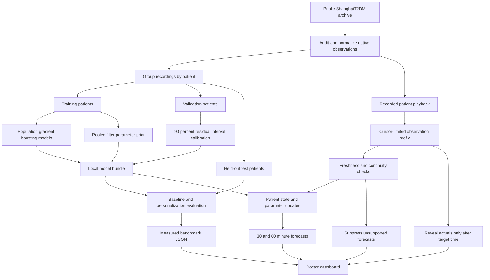

# Local prototype architecture

The implementation separates offline training/evaluation from the doctor replay. The model is a damped-trend engineering approximation, not a validated physiological simulator.

## Causal boundary

The replay handler slices the chosen recording before calling the forecasting interface. The filter has independent state within that call; changing patients does not reuse another patient's state. Each historical forecast is generated from its issuance prefix. Later actuals are joined by timestamp only after they are available. Alert acknowledgement lives in the UI and never reaches the forecasting engine.

The sensor-gap scenario intentionally withholds three most recent readings while preserving the replay clock. It is a simulated missing-data test on recorded observations, clearly distinct from the dataset's naturally occurring gaps.

## Fusion and adaptation

The population benchmark combines causal glucose-history features with age, sex, BMI and diabetes duration. Exact availability timestamps for baseline summary fields are absent; their use is a documented prototype assumption, and the context ablation tests their contribution.

The current filter starts from a training-cohort parameter prior and available glucose observations. It tracks level/trend and adapts damping/process noise from already-observed changes. Historical profile context is not yet a mechanistic parameter initialization. Same-filter pooled and adapted comparisons isolate parameter adaptation from state tracking.

## Delivery simplifications

- Local FastAPI and Vite development services; no live sensor connector, account system or external AI service.
- Flat files and a local joblib model bundle; no database.
- Public anonymized research data only; authentication is left as a documented future task before any nonlocal deployment.
- One primary recording per patient in the dashboard. Evaluation retains all recordings, grouped by patient; separate recordings are not stitched into an uninterrupted stream.
- Quantized native 15-minute observations. Warning times cannot establish finer clinical timing than the data resolution.

Benchmark protocol, split IDs, calibration method, actual metrics and limitations are stored with the generated evaluation artifacts.
