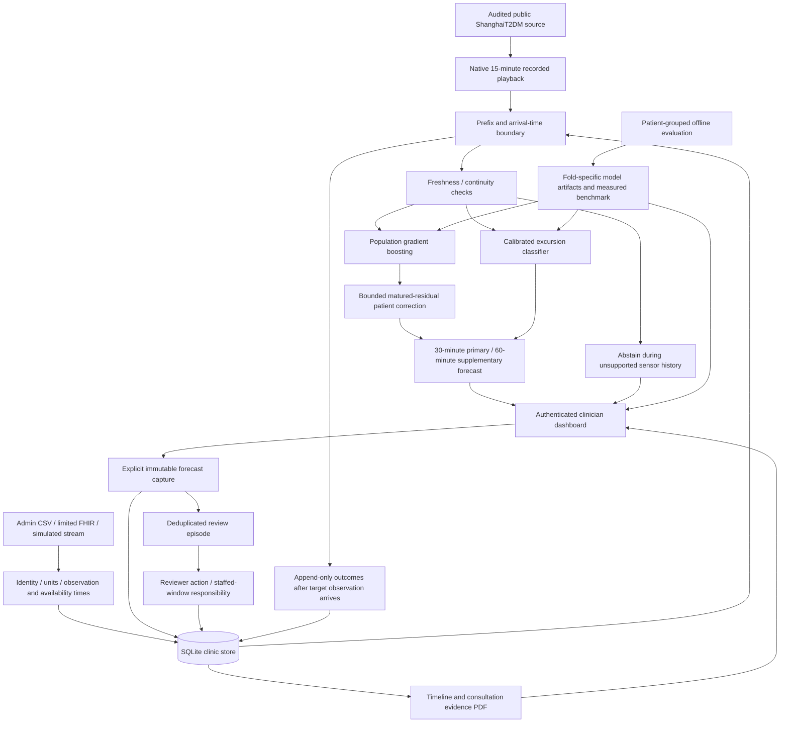

# GlucoTwin clinic prototype architecture

One workflow: identify a patient needing review → inspect available evidence → capture a forecast → document follow-up → compare the observed outcome → export consultation evidence. This is an engineering research prototype, with clinician review and prospective pilot approval pending.

## Runtime and delivery

React/TypeScript, Tailwind and Recharts provide the clinic queue, patient evidence screen, monitoring controls, review actions, intake, model evidence and report export. FastAPI owns authenticated APIs and the prefix-only forecasting functions. SQLite provides durable clinic records. No external AI provider is required.

Development uses Vite with an API proxy. The compiled deployment runs one origin: FastAPI serves `frontend/dist/index.html` at `/` and only the compiled asset directory at `/assets`, alongside `/api`. Runtime credentials/database/backups are never mounted as web files. The application is local until deployment controls are verified; an HTTPS reverse proxy is configured separately.

## Causality and model state

Measured CGM is preserved at its native 15-minute cadence. Missing readings remain missing. Replay exposes only the chosen recording prefix; imported history additionally requires both observation and availability time to be at or before the virtual clock. Imported times require explicit offsets and normalize to UTC. Native source timezone is unverified, so historical naive timestamps are labeled as a virtual dataset-local clock.

The main forecaster combines causal CGM features with available age, sex, BMI and diabetes duration. Historical Shanghai summary availability is an explicit source-data assumption; untimed labs, medications and future outcomes are excluded. Dated imported historical context is reconstructed independently at each prior forecast origin. Meals/activity/symptoms are evidence context until a predictive contribution is separately established.

Patient adaptation is a bounded, shrunk residual correction to the identical population predictor. It updates only after an earlier exact target reading arrives. Engineering level, trend, volatility and correction maturity are visible; they do not represent validated metabolic physiology. Patient state is reconstructed independently from available data, preventing contamination when switching patients.

A separately trained classifier estimates whether any native future reading exceeds 180 mg/dL. **30 minutes is the actionable review horizon**; 60 minutes is supplementary. Current observed glucose above the threshold becomes an `ongoing_high` item. Unsupported primary predictions cannot inherit warnings from the retained legacy filter. Predictive intervals and probabilities expose their empirical calibration limits.

The deliberate sensor-gap scenario withholds three recent readings while preserving the clock. Chart, timeline and consultation export use the same scenario/prefix. Actual outcomes become visible only when their observations are in that available prefix, including after scrubbing backward from a later replay time.

## Persistent clinician workflow

The ignored runtime database defaults to `.run/clinic.sqlite3`, configurable with `GLUCOTWIN_DB_PATH`. WAL is enabled. Numbered SQLite migrations use `PRAGMA user_version`: initial clinic tables, context semantic deduplication, then append-only forecast outcomes (current version **3**).

- Source public profiles and their audited CGM files remain separate from labeled synthetic/public CSV imports.
- Issued forecast records retain patient, model version, issue/input-cutoff time, scenario and a compact evidence snapshot. Their uniqueness key and an immutable-update trigger preserve earlier forecasts.
- Review episodes deduplicate the same patient/type while open. Actions progress through new → reviewed → follow-up planned → closed and retain actor, reason, note and next review time.
- Review acknowledgement does not modify the model, uncertainty, risk or benchmark score.
- Eventual exact-target glucose outcomes are appended on explicit capture or simulated stream ingestion. Complete native windows support event labels; unavailable outcomes are not invented.
- Recorded forecast clocks and wall-clock review audit times are labeled separately. Queue sensor freshness is age **at issue**, not a live reading-age claim.
- Staffed windows name a responsible reviewer. Outside hours, forecasts/review items remain available and monitoring is explicitly inactive. No emergency notification service is implemented.
- Consultation PDF generation escapes user-supplied text and exports observations, gaps, forecasts/observable actuals, unresolved reviews, notes and responsibility state.

## Access, intake and recovery

Passwords use salted PBKDF2-SHA256. Fresh installs use environment-supplied or randomly generated administrator/reviewer passwords; local bootstrap credentials are mode 0600 in `.run`. Revocable opaque bearer sessions expire after eight hours and are stored as hashes. Bearer authentication avoids relying on cross-site cookies. Patient/review/report queries derive clinic scope from the authenticated account, rather than trusting a client-supplied clinic ID.

Reviewer/admin users can review records and add care context. Administrator access is required for intake, monitoring changes and audit inspection. Default CSV/FHIR/stream intake is synthetic and excludes identifying fields. The administrator may attest an anonymized public ShanghaiT2DM CSV using the allowlisted source URL/license and `PUB-*` IDs; this is separate from source evaluation. Native cadence is retained. CSV/FHIR imports are single transactions, including validation, identity, units, conflicts, context and audit writes; failed requests leave no partial import.

The limited FHIR adapter accepts Patient, Condition, glucose/BMI Observation and CarePlan resources. Dated demographics and BMI can enter historical model context; condition/care-plan text remains evidence. Supported resource handling does not establish ABDM conformance certification or a live hospital connection.

Database, credentials and backups have restrictive file permissions. SQLite's backup API includes committed WAL changes. Stop the service before restoration, verify integrity and then verify persisted reviews after restart. File permissions are not encryption at rest. TLS, encrypted storage, consent/retention handling and operating monitoring require deployment validation before identifiable data is accepted.

## Evaluation and clinical release gates

The legacy benchmark is retained. The upgraded model is assessed with five outer patient folds, grouped inner selection and separate calibration patients, with all recordings for a patient grouped together. Runtime source profiles select their corresponding held-out fold artifact. Out-of-fold predictions, failures and patient-bootstrap uncertainty are published. Because this cohort has already been inspected, evidence is described as **internal retrospective validation**.

The selected warning operating point uses eligible forecast time, not a claim of staffed-clinic workload or prospective benefit. Doctor review of the workflow/operating point is pending. Measured performance does not establish clinical safety, regulatory approval or Indian generalization.

Before clinical use: obtain clinician-approved responsibilities/performance requirements, verify authorized device latency and identity, validate deployment/privacy/backup controls, complete applicable regulatory/ethics assessment, perform a prospective shadow evaluation, and only then consider supervised release. Live CGM vendor integration, automated treatment advice and causal therapy simulation are outside this prototype.
